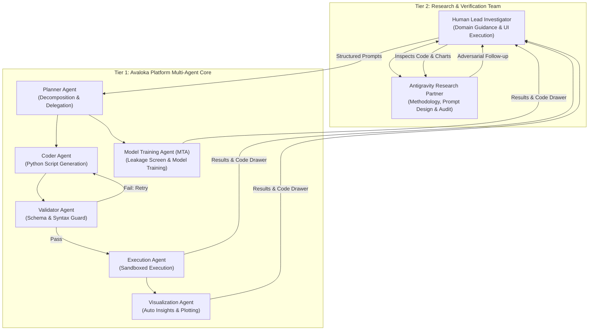

# AGENT ARCHITECTURE & COLLABORATIVE ROLES

**Project**: The 311 Response Gap: Can We Predict Which Public Complaints Will Take Too Long to Resolve?  
**Framework**: Multi-Agent Collaborative Data Intelligence

---

## 1. The Dual-Tier Agent Framework

This project operates across two complementary agent tiers:
1. **Tier 1: Avaloka Autonomous Digital Workforce (Platform Under Evaluation)**  
   The internal multi-agent graph running within Avaloka ([avaloka.ai](https://avaloka.ai)), responsible for parsing natural language prompts, writing Python code, validating schema compatibility, executing sandboxed compute, generating interactive visual insights, and training predictive models.
2. **Tier 2: The Research Team (Human-in-the-Loop Investigators)**  
   Composed of the **Human Lead Investigator** (Hackathon Participant) and **Antigravity** (Senior Data Science Research Engineer & Hackathon Partner). This tier formulates hypotheses, designs prompts, audits generated code, conducts adversarial follow-ups, and performs independent mathematical verification.



---

## 2. Tier 1: Avaloka Internal Agent Roles & Specifications

| Avaloka Agent | Primary Responsibility | Input Triggers | Output Artifacts | Quality / Failure Modes Monitored |
| :--- | :--- | :--- | :--- | :--- |
| **Planner Agent** | Orchestrates user prompts; breaks multi-part questions into logical execution stages; selects worker agents. | User natural language prompts via UI chat. | Structured execution plan; agent delegation graph. | Plan hallucination; misunderstanding domain semantics (e.g., confusing `agency` with `borough`). |
| **Coder Agent** | Authors high-performance, vectorized Python scripts (Pandas, NumPy, Scikit-Learn) to implement the analytical plan. | Tasks delegated from Planner Agent. | Python scripts, aggregation functions, transformation logic. | Inadvertent data mutation; incorrect datetime parsing; using mean on skewed data; target leakage. |
| **Validator Agent** | Pre-execution safety filter; validates code syntax against current DataFrame columns and data types. | Python script from Coder Agent. | Validation pass flag or structured error feedback to Coder. | False passes on subtle column name mismatches; type mismatch failures. |
| **Execution Agent** | Safely executes validated scripts inside sandboxed containerized compute (Ray cluster backend). | Validated Python scripts and active DataFrame. | Computed metric tables, DataFrames, console outputs. | Out-of-memory errors on large joins; execution timeouts. |
| **Visualization Agent** | Translates analytical tables into interactive web charts for the **Auto Insights** pane (up to 5 charts). | Computed data summaries from Execution Agent. | Interactive charts (Plotly / Vega / D3), metric cards. | Sub-optimal chart selection (e.g., pie chart on 50 categories); mislabeled axes. |
| **Model Training Agent (MTA)** | Manages end-to-end ML: screens for data leakage, defines train/test splits, proposes training plans, trains models, evaluates baselines, exposes inference API. | Model training requests from Planner Agent. | Model Run ID, ROC-AUC, PR-AUC, confusion matrix, inference card. | Leakage slippage; failing to compare with trivial baseline; arbitrary non-chronological splitting. |

---

## 3. Tier 2: Research Team Roles & Operational Protocol

### Role A: Human Lead Investigator (Hackathon Participant)
- **Primary Ownership**: Overall project vision, Avaloka account management, UI navigation, dataset upload, screen recording, and final form submission.
- **Workflow Actions**:
  - Uploads sanitized data files to the Avaloka web interface.
  - Submits the refined prompt sequences into Avaloka's chat.
  - Opens code drawers to inspect generated Python scripts.
  - Performs the 2-minute screen recording and audio voiceover.
  - Submits the final Google Form before Sunday 11:59 PM IST.

### Role B: Antigravity (Senior Data Science Research Engineer & Hackathon Partner)
- **Primary Ownership**: Methodological rigor, mathematical formulation, prompt engineering, code auditing, adversarial challenge design, and verification script authoring.
- **Workflow Actions**:
  - Authors the end-to-end analytical and machine learning protocols.
  - Formulates structured, mathematically unambiguous prompts for Avaloka.
  - Audits Avaloka's generated Python scripts for statistical hygiene, proper datetime parsing, and anti-leakage compliance.
  - Formulates targeted adversarial follow-up queries to challenge counter-intuitive AI outputs (e.g., verifying Simpson's Paradox on borough disparities).
  - Drafts and executes independent sandboxed cross-checking scripts to verify headline numbers.
  - Authors the publication-grade final report structure and executive syntheses.

---

## 4. Multi-Agent Handshake & Review Protocol

To ensure full transparency and auditability, every interaction follows a documented 4-step handshake:

```
[Prompt Design]      Antigravity crafts bounded prompt targeting specific hypothesis.
         │
         ▼
[UI Execution]       Human Lead enters prompt into Avaloka; observes Planner & Coder.
         │
         ▼
[Code & Output Log]  Human Lead captures Avaloka's generated Python script and output tables.
         │
         ▼
[Peer Audit]         Antigravity audits code for hygiene; if anomaly found, generates 
                     adversarial follow-up prompt to challenge Avaloka's finding.
```

