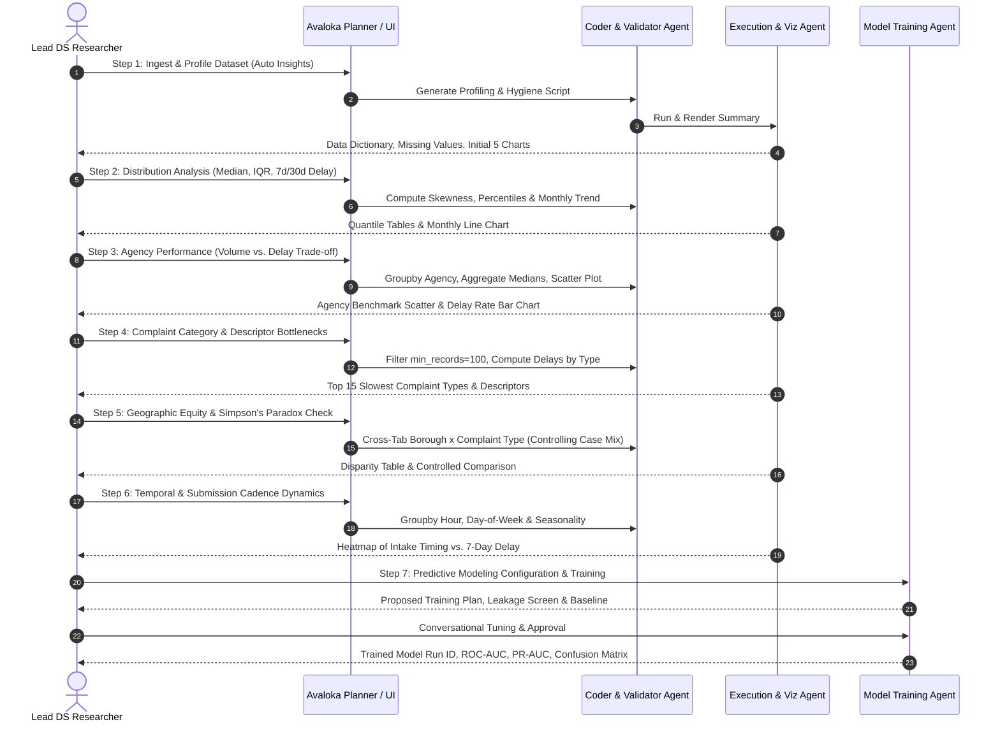

# AVALOKA INTERACTION & ANALYSIS PLAN

**Project**: The 311 Response Gap: Can We Predict Which Public Complaints Will Take Too Long to Resolve?  
**Target Platform**: Avaloka AI (https://avaloka.ai)

---

## 1. Operating Philosophy: Conversational Data Science with Multi-Agent Inspection

Avaloka is not an opaque visualization tool; it is a multi-agent orchestration engine. When a user enters a query, the **Planner Agent** parses the intent, the **Coder Agent** writes executable Python code, the **Validator Agent** sanity-checks the code against the active DataFrame schema, the **Execution Agent** runs the script, and the **Visualization Agent** renders up to five interactive charts in the *Auto Insights* pane.

Our analytical workflow follows a 4-step loop for every analytical step:
1. **Prompt**: Submit a precise, mathematically bounded prompt.
2. **Inspect**: Open Avaloka's generated code drawer to inspect the exact Python/Pandas logic.
3. **Verify**: Check calculations against known statistical baselines and data hygiene boundaries.
4. **Challenge**: Submit a conversational follow-up if an anomaly, confounding factor, or counter-intuitive claim appears.

---

## 2. Sequence of Structured Avaloka Prompts

---

### Step 1: Dataset Profiling, Schema Validation & Data Hygiene

#### Primary Prompt:
> *"Please profile our uploaded NYC 311 dataset (`nyc_311_analytical_full.csv`). Identify all column data types, calculate missing value percentages for every column, check for duplicate records on `unique_key`, and verify the date range for `created_date` and `closed_date`. Display summary statistics for numerical and temporal fields, and show the initial Auto Insights charts."*

#### What to Inspect in Avaloka:
- **Coder Agent Script**: Confirm that dates were parsed with `pd.to_datetime(..., errors='coerce')`.
- **Auto Insights Panel**: Review the 5 automatically generated charts (e.g., distribution of complaints, top agencies).
- **Sanity Check**: Ensure that row count matches our uploaded sample (~115,000–120,000 rows) and that no non-null fields were erroneously parsed as NaN.

---

### Step 2: Overall Resolution Distribution & Delay Rates

#### Primary Prompt:
> *"Calculate the overall resolution duration in decimal days as `(closed_date - created_date)`. Report the mean, standard deviation, median, 25th percentile, 75th percentile, 90th percentile, and 99th percentile. What exact percentage of complaints take > 7 calendar days to resolve, and what percentage take > 30 calendar days? Plot a histogram with a logarithmic x-axis showing the resolution time distribution, and a monthly trend line of the 7-day delay rate across 2024 and 2025."*

#### What to Inspect in Avaloka:
- **Coder Agent Script**: Check whether negative resolution times exist and whether they were filtered out (`duration >= 0`).
- **Statistical Integrity**: Confirm that median is prioritized over mean due to extreme positive skewness.
- **Verification Question**: Does the 7-day delay rate match manual calculation: $\frac{\sum \mathbb{I}(\Delta t > 7)}{N}$?

---

### Step 3: Agency-Level Operational Benchmarks

#### Primary Prompt:
> *"Group the complaints by `agency`. For each agency, compute: (1) total complaint volume, (2) median resolution duration in days, (3) interquartile range (IQR), and (4) the percentage of complaints taking > 7 days. Rank the agencies by median resolution time. Generate a scatter plot comparing total volume (log-scale x-axis) against median resolution time (y-axis) to evaluate whether high-volume agencies are structurally slower."*

#### Follow-Up / Adversarial Challenge Prompt:
> *"Looking at the scatter plot, does complaint volume correlate with longer median resolution times? If NYPD handles the highest volume but has one of the shortest median resolution times, explain why volume alone does not dictate turnaround speed. What operational differences explain this?"*

#### What to Inspect in Avaloka:
- Ensure the AI distinguishes operational mandates (e.g., mobile patrol enforcement vs. physical onsite housing inspections) from municipal efficiency.

---

### Step 4: Complaint Category & Problem Typology Bottlenecks

#### Primary Prompt:
> *"Filter for complaint types with at least 100 cases. Identify the top 15 complaint types with the longest median resolution times, and contrast them with the top 15 most frequent complaint types. Create a horizontal bar chart displaying the 7-day delay rate for each of the top 15 slowest complaint types, indicating their primary responding agency."*

#### Follow-Up / Adversarial Challenge Prompt:
> *"For the complaint types with the longest resolution times, examine their `descriptor` values. Are specific sub-descriptors responsible for the delay, or is the entire category delayed across the board? Provide the median resolution time for the top descriptors within the slowest category."*

---

### Step 5: Geographic Disparities & Simpson's Paradox Investigation

#### Primary Prompt:
> *"Analyze resolution time across the five boroughs: BRONX, BROOKLYN, MANHATTAN, QUEENS, and STATEN ISLAND. Exclude or separate 'Unspecified'. For each borough, show total complaint count, median resolution days, and the percentage of cases delayed > 7 days. Plot a comparative bar chart of the 7-day delay rate across boroughs."*

#### Critical Simpson's Paradox Control Prompt:
> *"The Bronx appears to have a higher 7-day delay rate than Manhattan. Is this because municipal services operate slower in the Bronx, or because the Bronx has a higher proportion of complex housing complaints (HPD)? Run a controlled comparison: calculate the median resolution time and 7-day delay rate by borough ONLY for 'HEAT/HOT WATER' complaints, and separately ONLY for 'Illegal Parking' complaints. Does the borough disparity persist when controlling for complaint category?"*

#### What to Inspect in Avaloka:
- Look for evidence of **Simpson's Paradox** where aggregate borough disparities diminish or invert once complaint mix is held constant.

---

### Step 6: Temporal Cadence & Intake-Time Dynamics

#### Primary Prompt:
> *"Investigate the relationship between when a complaint is submitted and its subsequent resolution speed. Group by (1) `submission_month`, (2) `submission_day_of_week` (Monday through Sunday), and (3) `submission_hour` (0 through 23). For each grouping, calculate the 7-day delay rate. Create a heatmap or grouped bar chart displaying the 7-day delay rate by day of week and submission hour."*

#### Follow-Up Prompt:
> *"Are complaints submitted on Friday afternoons or over the weekend significantly more likely to take > 7 days than complaints submitted on Tuesday mornings? What is the odds ratio or percentage difference?"*

---

### Step 7: Synthesis & Formulation of Predictive Modeling

#### Primary Prompt:
> *"Synthesize our findings from the exploratory analysis. Which features (agency, complaint type, borough, submission timing) demonstrated the strongest association with 7-day delays? Based on this empirical evidence, let us formulate our binary classification problem to predict `delayed_over_7d` using only intake-time information."*

