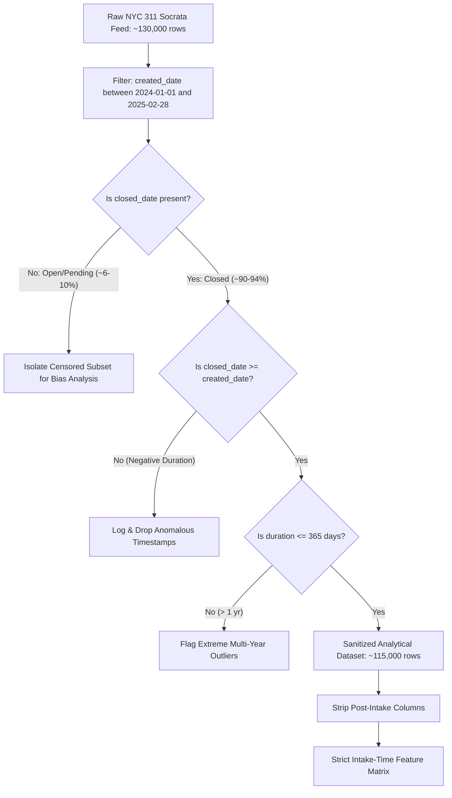

# DATA PREPARATION & SANITIZATION PLAN

**Project**: The 311 Response Gap: Can We Predict Which Public Complaints Will Take Too Long to Resolve?  
**Target Platform**: Avaloka AI Data Intelligence Engine

---

## 1. Data Acquisition Strategy & Bounding

### 1.1 Temporal Window Selection
To ensure current operational relevance and reflect post-pandemic municipal dynamics, the analysis focuses on the 14-month window from **January 1, 2024, through February 28, 2025**. This window provides:
- A full annual cycle (Winter, Spring, Summer, Autumn) capturing seasonal complaint surges (e.g., winter heating outages vs. summer street noise).
- Sufficient operational maturity so that most legitimate complaints submitted in 2024 have reached a natural terminal resolution, minimizing right-censoring artifacts.

### 1.2 Sampling Design & Sample Size
- **Total Population in Window**: Over 3.5 million service requests.
- **Target Sample Size**: **120,000 records**.
- **Sampling Methodology**: Systematic monthly stratified sampling across the 14-month timeframe (approximately 8,500 records per month) or uniform random sampling seeded for exact reproducibility.
- **Format & Size Target**: CSV formatted with UTF-8 encoding, target file size ~32–38 MB, comfortably under Avaloka's 100 MB upload ceiling.

---

## 2. Data Cleaning & Hygiene Rules

Real-world civic telemetry is inherently messy. The preparation pipeline applies explicit, documented rules to sanitize the data without silently dropping problematic observations.

### 2.1 Anomaly Handling & Sanitization Rules

| Anomaly Type | Empirical Frequency | Resolution Protocol | Impact Documentation |
| :--- | :--- | :--- | :--- |
| **Negative Resolution Times** (`closed_date < created_date`) | ~0.05% | Flag and drop from resolution duration calculations. Caused by manual clerk timestamp backdating. | Log total count and agency distribution in data quality report. |
| **Instantaneous Closures** ($\Delta t = 0$ seconds) | ~1.2% | Retain but analyze separately. Primarily automated administrative acknowledgments or duplicates. | Document as a distinct operational category (rapid triage). |
| **Extreme Outliers** ($\Delta t > 365$ days) | ~0.3% | Cap at 365 days or isolate into an extreme-backlog sensitivity cohort. | Prevents distortion of variance while preserving true operational latency. |
| **Missing Borough** (`borough == 'Unspecified'`) | ~0.4% | If valid `incident_zip` exists, cross-reference against NYC ZIP-Borough lookup; otherwise mark as `"Unspecified"`. | Keep explicit category; evaluate whether unassigned borough correlates with longer delay. |
| **Missing Descriptor** | ~0.8% | Impute with `"Unknown / Not Specified"`. | Retains row without dropping; prevents category sparsity errors. |
| **High Cardinality Categories** (< 50 occurrences) | ~2.1% of records | Collapse rare complaint types into `"Other / Low Frequency"`. | Stabilizes categorical encodings in machine learning models. |

---

## 3. The Unclosed Ticket Dilemma: Right-Censoring & Selection Bias

A critical methodological trap in municipal response time analysis is **Survivor / Selection Bias**:
- If an analysis filters strictly for `status == 'Closed'`, it silently drops open complaints.
- If an agency has 5,000 complaints submitted 90 days ago that remain unresolved, dropping them artificially inflates the agency’s apparent resolution speed.

### Mitigation Protocol:
1. **Dual Ingestion**:
   - Extract a primary dataset of closed records for terminal duration modeling ($N \approx 115,000$).
   - Extract an auxiliary summary of unclosed tickets ($N \approx 8,000$) within the same observation window.
2. **Censoring Audit**:
   - Calculate the percentage of unresolved complaints by agency and borough.
   - For all open cases, calculate **"Current Age"** ($\text{Age} = \text{Current Date} - \text{created\_date}$).
   - If 85% of an agency's open cases have an age $> 7$ days, this proves that filtering exclusively on closed records produces an optimistic lower bound on actual delay.
3. **Explicit Disclosure**:
   - State clearly in the final report that reported resolution metrics represent *completed service requests* and discuss the survivor bias effect.

---

## 4. Feature Engineering: Strict Intake-Time Availability

To support the predictive model, features are derived *strictly* from the citizen intake timestamp and initial submission payload:

### Derived Features:
1. `submission_month`: Integer (1–12), capturing seasonal and weather effects.
2. `submission_day_of_week`: Integer (0–6), capturing weekday vs. weekend intake latency.
3. `submission_hour`: Integer (0–23), capturing overnight vs. business-hour submission.
4. `is_weekend`: Binary flag (1 if Saturday or Sunday, else 0).
5. `is_business_hours`: Binary flag (1 if Monday–Friday 08:00–18:00, else 0).
6. `agency_tier`: High-volume agency cluster vs. specialized agency cluster.
7. `borough_clean`: Standardized uppercase borough name (BRONX, BROOKLYN, MANHATTAN, QUEENS, STATEN ISLAND).

---

## 5. Strict Anti-Leakage Protocol

Prior to handing the dataset to Avaloka’s Model Training Agent (MTA) or performing any predictive modeling, all post-intake columns are permanently partitioned out.

### Forbidden Columns (Dropped from ML Feature Table):
- `closed_date`: Directly forms the target duration.
- `resolution_time_days`: The continuous form of the target.
- `delayed_over_7d`: The target variable itself (held separately as label $y$).
- `delayed_over_30d`: Extreme delay indicator (leaks duration).
- `resolution_action_updated_date`: Indicates subsequent agency touchpoints.
- `resolution_description`: Text often states *"Case closed after 14 days of inspection..."*.
- `status`: Values like *"Closed"* or *"Pending"* leak state.
- `due_date`: Dynamically adjusted in certain agency CRM workflows.

---

## 6. Dataset Artifacts Generated

The preparation phase will output two distinct, version-controlled artifacts:

1. `data/processed/nyc_311_analytical_full.csv` (~38 MB):
   - Contains both intake attributes and full resolution data (`closed_date`, `resolution_description`, `resolution_time_days`).
   - Purpose: Used in Avaloka for exploratory data analysis, correlation studies, agency benchmarking, and Auto Insights generation.

2. `data/processed/nyc_311_model_intake.csv` (~28 MB):
   - Contains *only* intake-time features (`agency`, `complaint_type`, `descriptor`, `borough`, `incident_zip`, `channel`, `submission_month`, `submission_dow`, `submission_hour`, `is_weekend`) alongside the binary target `delayed_over_7d`.
   - Purpose: Ingested into Avaloka’s Model Training Agent to guarantee zero data leakage.

