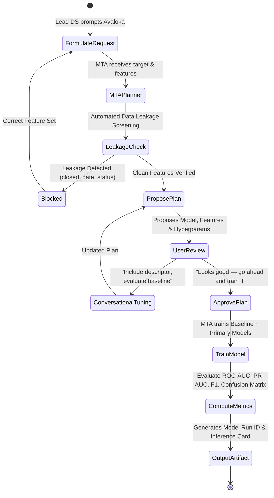

# PREDICTIVE MODELING & EVALUATION PLAN

**Project**: The 311 Response Gap: Can We Predict Which Public Complaints Will Take Too Long to Resolve?  
**Execution Engine**: Avaloka Model Training Agent (MTA) & Validation Framework

---

## 1. Problem Formulation

The operational challenge for municipal administrators is identifying high-risk service requests at the moment of intake so that triage teams can intervene before statutory service-level agreements (SLAs) are breached. 

We formulate this as a **supervised binary classification problem**:

$$\hat{y}_i = f(\mathbf{x}_i^{\text{intake}}) \in [0, 1]$$

Where:
- $\mathbf{x}_i^{\text{intake}}$ is the feature vector composed *strictly* of information available when complaint $i$ is submitted.
- $y_i$ is the ground-truth binary outcome:
  $$y_i = \begin{cases} 1 & \text{if } (\text{closed\_date}_i - \text{created\_date}_i) > 7.0 \text{ calendar days} \\ 0 & \text{if } (\text{closed\_date}_i - \text{created\_date}_i) \le 7.0 \text{ calendar days} \end{cases}$$

---

## 2. Feature Architecture & Anti-Leakage Partitioning

### 2.1 Authorized Intake-Time Feature Matrix ($\mathbf{x}^{\text{intake}}$)

| Feature Name | Type | Encoding / Transformation | Operational Intuition |
| :--- | :--- | :--- | :--- |
| `agency` | Nominal Categorical | One-Hot / Frequency Encoding | Responding agency jurisdiction and operational cadence. |
| `complaint_type` | Nominal Categorical | High-Frequency One-Hot (>100 count) | Primary problem type; strong determinant of complexity. |
| `descriptor` | Nominal Categorical | Target / Frequency Encoding | Specific nuance (e.g., "Entire Building" vs "Single Room"). |
| `borough` | Nominal Categorical | One-Hot (5 Boroughs + Unspecified) | Geographic jurisdiction and local borough depot dispatch. |
| `open_data_channel_type` | Nominal Categorical | One-Hot (Phone, Online, Mobile, etc.) | Intake channel proxy for citizen urgency / demographics. |
| `location_type` | Nominal Categorical | One-Hot (Residential, Street, Commercial) | Physical context of the required inspection. |
| `submission_month` | Cyclical / Categorical | Cyclical sine/cosine or categorical | Seasonal patterns (e.g., winter freeze vs summer heat). |
| `submission_dow` | Cyclical / Categorical | Categorical (0=Mon ... 6=Sun) | Weekday intake vs weekend backlog accumulation. |
| `submission_hour` | Cyclical / Numeric | Integer (0–23) or morning/afternoon/night | Business hours dispatch vs overnight queueing. |
| `is_weekend` | Binary Flag | {0, 1} | Immediate 48-hour administrative latency flag. |
| `incident_zip` | Categorical / Spatial | Top 50 ZIPs One-Hot or Target Encoded | Neighborhood-level structural infrastructure indicator. |

### 2.2 Prohibited Features (Post-Intake Data Leakage)
Under no circumstances may any of the following variables be accessible to the feature pipeline:
- `closed_date`, `resolution_time_days`, `delayed_over_30d` (target leakage)
- `status` (leaks whether request is completed or closed)
- `resolution_action_updated_date` (leaks elapsed operational duration)
- `resolution_description` (text contains post-inspection findings)
- `due_date` (often dynamically revised post-intake)

---

## 3. Evaluation Split: Chronological vs. Random

Random $k$-fold cross-validation or random 80/20 train/test splitting is **strictly rejected** as the primary evaluation methodology for this investigation. 

### Why Random Splitting is Flawed for Civic Telemetry:
1. **Temporal Leakage**: A random split allows models to train on records from December 2024 to predict records from January 2024, artificially leaking seasonal weather events, policy changes, and citywide labor actions backward in time.
2. **Real-World Operational Validity**: Municipal dispatchers never predict past events using future data; they train on historical data to predict *unfolding future complaints*.

### Enforced Chronological Split Design:
- **Training Cohort ($T_{\text{train}}$)**: Earlier 70% of chronological records (e.g., January 1, 2024, through September 30, 2024).
- **Validation / Tuning Cohort ($T_{\text{val}}$)**: Subsequent 10% (e.g., October 1, 2024, through November 15, 2024).
- **Out-of-Time Test Cohort ($T_{\text{test}}$)**: Final 20% of records (e.g., November 16, 2024, through February 28, 2025).

---

## 4. Avaloka Model Training Agent (MTA) Interaction Protocol

Avaloka provides a dedicated **Model Training Agent (MTA)** designed to handle machine learning workflows through conversational natural language.

### Conversational Prompt Sequence for Avaloka MTA:
1. **Model Request**:  
   > *"We want to build a machine learning model to predict whether a complaint will take more than 7 days to close (`delayed_over_7d`). Use ONLY intake-time features: `agency`, `complaint_type`, `descriptor`, `borough`, `incident_zip`, `open_data_channel_type`, `submission_month`, `submission_dow`, and `submission_hour`. Check for data leakage, set up a baseline model, and propose a training plan."*
2. **Review Proposed Plan**: Inspect the MTA’s proposed architecture (e.g., Logistic Regression vs. Random Forest/Gradient Boosting, categorical encoders, class weighting).
3. **Conversational Tuning**:  
   > *"Ensure that class weights are balanced to account for class imbalance, and evaluate against both a majority-class baseline and an agency-only baseline. Let us train with an 80/20 chronological split."*
4. **Final Approval**:  
   > *"The plan looks solid and leak-free. Go ahead and train the model."*
5. **Artifact Capture**: Extract the resulting Model Run ID, confusion matrix, and feature importances.

---

## 5. Model Candidate Hierarchy & Baselines

To rigorously evaluate whether machine learning adds actionable value, we compare at least three tiers of models:

### 1. Baseline 1: Majority-Class (Zero-R) Baseline
- Predicts $\hat{y} = 0$ (not delayed) for all incoming complaints.
- If 80% of complaints are resolved within 7 days, this naive baseline achieves **80.0% accuracy** while achieving **0.0% recall** on delayed cases. This establishes why accuracy is an uninformative metric for municipal risk management.

### 2. Baseline 2: Historical Agency-Prior Baseline
- Predicts $\hat{y} = 1$ if the responding agency’s historical 7-day delay rate exceeds 50%.
- Captures whether a simple agency lookup table is sufficient, or whether granular complaint attributes provide incremental predictive lift.

### 3. Model 1: Regularized Logistic Regression (Linear Benchmark)
- $L_2$-penalized logistic regression with one-hot encoded categorical features.
- Provides fully interpretable coefficients and odds ratios for city planners.

### 4. Model 2: Tree-Based Non-Linear Model (Random Forest / Gradient Boosted Trees)
- Captures complex non-linear interactions (e.g., a specific descriptor within HPD in a specific borough behaving fundamentally differently than the same descriptor elsewhere).

---

## 6. Comprehensive Evaluation Metric Suite

For the out-of-time test cohort, we evaluate:

1. **ROC-AUC (Area Under the Receiver Operating Characteristic Curve)**:  
   Evaluates rank-ordering ability across all possible discrimination thresholds.
2. **PR-AUC (Precision-Recall AUC / Average Precision)**:  
   Critical metric for imbalanced classes ($y=1$ is typically 15–25% of cases).
3. **Recall (Sensitivity for Delayed Complaints)**:
   $$\text{Recall} = \frac{\text{True Positives}}{\text{True Positives} + \text{False Negatives}}$$
4. **Precision (Positive Predictive Value)**:
   $$\text{Precision} = \frac{\text{True Positives}}{\text{True Positives} + \text{False Positives}}$$
5. **F1-Score / $F_\beta$-Score**: Harmonic mean, with $F_2$-score calculated to weight recall twice as heavily as precision.
6. **Brier Score & Probability Calibration**:
   $$\text{Brier} = \frac{1}{N} \sum_{i=1}^N (\hat{p}_i - y_i)^2$$
   Assesses whether predicted probability $\hat{p} = 0.70$ corresponds to an empirical 70% delay frequency.

---

## 7. Asymmetric Operational Loss & Decision Threshold Analysis

In municipal dispatch, classification errors have deeply asymmetrical operational consequences:

| Error Type | Concrete Real-World Consequence | Cost Weight |
| :--- | :--- | :--- |
| **False Negative (Type II)** | A complaint predicted to close quickly actually languishes for 3 weeks without intervention. Result: Citizen suffers unheated apartment or safety hazard, files escalations to City Council, public trust erodes. | **HIGH COST** |
| **False Positive (Type I)** | A complaint predicted to delay is resolved in 4 days. Result: Minor triage review by dispatch supervisor; no citizen harm. | **LOW COST** |

### Decision Threshold Optimization:
Standard classification applies a default decision threshold of $\tau = 0.50$. Because False Negatives are substantially more damaging than False Positives in public service delivery, we evaluate optimal decision thresholds across $\tau \in [0.20, 0.40]$ to maximize **Recall at acceptable Precision**, demonstrating practical operational maturity.

