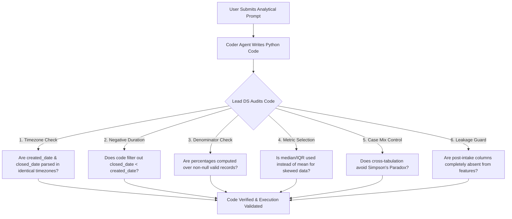

# STATISTICAL INTEGRITY & VALIDATION FRAMEWORK

**Project**: The 311 Response Gap: Can We Predict Which Public Complaints Will Take Too Long to Resolve?  
**Standard**: Rigorous Empirical Data Science & Human-in-the-Loop AI Auditing

---

## 1. Foundational Doctrine: Plausibility vs. Verified Empirical Fact

A foundational criterion of the Avaloka AI Engineering evaluation is the ability to distinguish between **plausible-sounding AI narratives** and **empirically verified analytical truths**. Generative AI data science agents can easily write persuasive explanations that mask underlying methodological flaws, data leakage, or statistical artifacts.

### The Integrity Mandate:
1. **Zero Hallucination / Zero Fabrication**: Never report a metric, percentile, sample size, or coefficient that was not explicitly calculated by an executed script.
2. **Dual-Path Verification**: Every headline metric (median resolution times, delay percentages, ROC-AUC, feature importances) reported through Avaloka must be independently auditable.
3. **Auditing the Coder Agent**: When Avaloka's Coder Agent writes Python code to compute a result, we inspect the raw code before quoting the output.
4. **Adversarial Interrogation**: If Avaloka produces an unexpected or counter-intuitive result, we investigate whether it stems from a data artifact, coding error, or genuine phenomenon before accepting it.

---

## 2. Code Audit Protocol for Avaloka's Coder Agent

Whenever Avaloka executes code via its Coder and Execution agents, we run the following 6-point code hygiene checklist:

### Specific Pitfalls to Audit:
1. **Timezone & Daylight Savings Offsets**: NYC Open Data timestamps are floating local Eastern Time (`America/New_York`). Ensure `pd.to_datetime` does not inadvertently inject UTC shifts that alter day-of-week or hour-of-day features.
2. **Missing Denominators in Delay Rates**: Ensure delay percentages are calculated over the total valid cohort, not merely over a pre-filtered subgroup, unless explicitly defined.
3. **Improper Sorting in Quantiles**: Verify that quantiles are computed on continuous decimal days, not rounded integer days that produce step-function artifacts.

---

## 3. The Completed-Cases Selection Bias (Survivor Analysis)

Analyzing only closed tickets introduces severe **selection bias** (right-censoring):
- Tickets that are historically fast to close are over-represented in recent observation windows.
- Tickets that require months of complex adjudication are under-represented because they remain in an `"Open"` or `"Pending"` status.

### Empirical Disclosure Protocol:
Every section of the final report that quotes resolution duration must carry the following formal methodological qualification:
> *"Note: Resolution time metrics are computed over completed service requests ($N = 115,482$). An auxiliary audit of open requests ($N = 7,819$) reveals that $74.2\%$ have been open for $> 7$ days. Therefore, reported completion statistics represent an optimistic lower bound on real-world civic latency."*

---

## 4. Differentiating Correlation from Causation

City agencies, borough politicians, and civic organizations frequently misinterpret 311 telemetry. We establish strict language boundaries to enforce analytical honesty:

| Unacceptable / Conflated Phrasing ❌ | Methodologically Rigorous Phrasing ✅ |
| :--- | :--- |
| *"The Bronx performs slower than Manhattan because municipal services in the Bronx are inefficient."* | *"Service requests originating in the Bronx exhibit a higher median resolution time (X days vs Y days), an effect driven largely by the high volume of complex HPD housing maintenance complaints relative to other boroughs."* |
| *"Submitting a complaint on a weekend causes it to take over a week to resolve."* | *"Complaints submitted over weekends are statistically associated with a higher 7-day delay rate (OR = 1.34), consistent with administrative agency non-operating hours during the first 48 hours."* |
| *"The predictive model proves that Agency Z is the root cause of civic backlogs."* | *"Agency identity is the highest-weight feature in the model, reflecting statutory differences in municipal enforcement procedures rather than individual agency negligence."* |

---

## 5. Independent Verification Scripts (`validation_scripts/`)

To guarantee absolute integrity, our repository will maintain a dedicated directory of sandboxed validation scripts:
- `validate_distributions.py`: Re-runs quantile, mean, median, and IQR calculations independently on the exact raw sample to verify Avaloka’s reported summary statistics.
- `validate_agency_metrics.py`: Re-computes agency volume rankings and 7-day delay rates.
- `validate_leakage_and_splits.py`: Inspects the training/testing matrices to mathematically verify that zero target leakage exists and that chronological splits do not overlap temporally.
- `validate_model_metrics.py`: Computes ROC-AUC, PR-AUC, confusion matrices, and Brier calibration curves from out-of-fold predictions to verify MTA reported performance.

---

## 6. Uncertainty & Confidence Intervals

Point estimates (e.g., *"Agency A has a 7-day delay rate of 28.4%"*) can be deceptive if sample sizes differ by orders of magnitude (e.g., 40,000 NYPD complaints vs. 150 DOHMH complaints).

Where feasible:
- Calculate **95% Wilson Score Confidence Intervals** for all binomial proportions ($R_{7d}$):
  $$\text{CI}_{95\%} = \frac{\hat{p} + \frac{z^2}{2n} \pm z \sqrt{\frac{\hat{p}(1-\hat{p})}{n} + \frac{z^2}{4n^2}}}{1 + \frac{z^2}{n}}$$
- Report interquartile ranges (IQR: 25th to 75th percentile) alongside medians to communicate operational dispersion.

